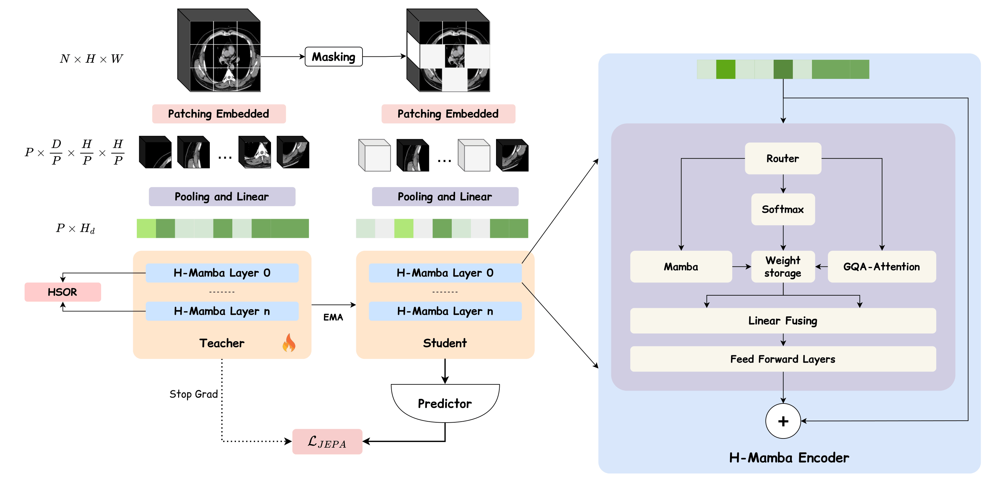

# Rad-JEPA 3D — Source Code

[](https://arxiv.org/abs/2607.26196) | Quoc-Huy Trinh, Minh-Van Nguyen, Ulas Bagci

## Architecture

<p align="center">
  
</p>

<p align="center"><em>
Rad-JEPA 3D pretraining pipeline. A 3D CT volume is patchified into 1024 tokens via Conv3d(8,16,16).
75% of tokens are masked; the visible 25% are encoded by the Context Encoder (H-Mamba x 12, trained with gradient),
while the full token set passes through the Target Encoder (EMA-updated copy, no gradient).
A lightweight Predictor reconstructs masked representations in latent space via L1 loss.
Hidden States Orthogonal Regularization (HSOR) aligns per-layer features between context and target encoders,
and a soft orthogonality regularizer (||W<sup>T</sup>W - I||<sup>2</sup>) reduces weight redundancy.
</em></p>

## Directory Structure

```
src/
├── vjepa_model.py          # MambaEncoder, VJEPAPredictor, VJEPA3D, HSOR
├── vjepa_config.py         # VJEPAConfig dataclass
├── vjepa_hybrid.py         # HybridBlock (H-Mamba), 3D RoPE, GQA
├── example.py              # Loading examples (encoder + MLLM)
│
├── utils/                  # Shared utilities
│   ├── load_checkpoint.py  # Unified checkpoint loading
│   ├── encoders.py         # Encoder registry (RadJepa, Merlin, Swin, VoCo, Genesis)
│   ├── m3d_eval.py         # Shared eval harness (case-disjoint, kNN, linear probe)
│   ├── vjepa_data.py       # M3DCTDataset, InspectSSLDataset, MergedSSLDataset
│   ├── vjepa_masking.py    # RandomMasker, BlockMasker
│   ├── vjepa_utils.py      # EMA schedule, LR lambda, checkpointing
│   ├── inspect_data.py     # INSPECT CTPA dataset + HU windows
│   ├── bench_ablations_clean.py  # Ablation benchmark library
│   ├── config.py           # CoT pipeline config
│   ├── data_loader.py      # CoT data loading
│   ├── generator.py        # Qwen3 batch inference
│   ├── prompts.py          # CoT system + user prompts
│   └── qc.py               # Quality control (schema, leakage, fabrication)
│
├── training/               # Training scripts
│   ├── train_jepa.py       # V-JEPA SSL pretraining
│   ├── train_hybrid3d.py   # Hybrid3D late-fusion pretraining
│   ├── train_mllm.py       # MLLM 2-stage training
│   └── train_seg.py        # 3D segmentation training
│
├── infer/                  # Inference & data extraction
│   ├── generate_cot.py     # CoT conversation generation
│   ├── extract_m3d.py      # M3D-Cap ZIP -> .npy extraction
│   ├── extract_inspect.py  # INSPECT NIfTI -> .npy (HU preserved)
│   ├── extract_texts.py    # Radiology report text extraction
│   ├── download_seg.py     # M3D-Seg dataset download
│   └── merge_shards.py     # Merge sharded benchmark results
│
├── test/                   # Benchmarks, evaluation, visualization
│   ├── bench_m3d.py        # M3D frozen-feature kNN benchmark
│   ├── bench_ablations.py  # Epoch-matched ablation benchmark
│   ├── bench_mllm.py       # MLLM VQA + captioning benchmark
│   ├── bench_spatialmed.py # SpatialMed spatial reasoning
│   ├── bench_textonly.py   # Text-only LLM baseline
│   ├── eval_inspect.py     # INSPECT multi-label evaluation
│   ├── eval_seg.py         # Per-organ segmentation Dice
│   ├── report_m3d.py       # M3D comparison table (text + LaTeX)
│   ├── report_ablations.py # Ablation table with significance
│   ├── probe_router.py     # Router gate statistics
│   ├── plot_router.py      # Router figures
│   ├── viz_encoder.py      # Encoder saliency maps
│   ├── viz_encoder_more.py # PCA + correlation analysis
│   ├── viz_attention.py    # Mamba feature visualization
│   └── viz_hybrid.py       # Hybrid GQA attention + router maps
│
├── mllms/                  # Multimodal LLM package
│   ├── config.py           # MLLMConfig
│   ├── model.py            # Med3DMLLM (vision + projector + LLM)
│   ├── data.py             # VQA + captioning datasets
│   ├── benchmark.py        # Benchmark library (shared metrics)
│   └── spatialmed_taxonomy.py
│
├── seg/                    # 3D segmentation package
│   ├── config.py           # SegConfig
│   ├── model.py            # SegModel (encoder + conv decoder)
│   └── data.py             # Multi-dataset loader
│
├── hybrid3d/               # Hybrid late-fusion architecture
│   ├── config.py           # Hybrid3DConfig
│   ├── model.py            # HybridLateFusion (two-branch)
│   ├── mamba_branch.py     # BiMamba with Morton/raster scan
│   ├── transformer_branch.py
│   ├── fusion.py           # concat / sum / gated / cross-attn
│   ├── serialize.py        # Morton Z-order curve
│   ├── masking.py          # Shared volume-space masking
│   ├── stems.py            # 3D patch embedding
│   └── ssl_modules/        # JEPA pretraining (predictor, EMA target)
│
└── imgs/
    └── architecture.png    # Architecture diagram
```

## Training

| Script | Description | Usage |
|--------|-------------|-------|
| `train_jepa.py` | V-JEPA SSL pretraining (single/multi-GPU) | `torchrun --nproc_per_node=4 training/train_jepa.py` |
| `train_hybrid3d.py` | Hybrid3D late-fusion pretraining | `python training/train_hybrid3d.py --gpu-ids 2,3` |
| `train_mllm.py` | MLLM 2-stage training (projector then LoRA) | `torchrun --nproc_per_node=4 training/train_mllm.py --stage 1` |
| `train_seg.py` | Multi-class 3D segmentation | `torchrun --nproc_per_node=4 training/train_seg.py` |

## Inference & Extraction

| Script | Description | Usage |
|--------|-------------|-------|
| `generate_cot.py` | Generate CoT diagnostic conversations | `python infer/generate_cot.py generate --gpu-ids 6,7 --resume` |
| `extract_m3d.py` | Extract M3D-Cap volumes from ZIP to `.npy` | `python infer/extract_m3d.py` |
| `extract_inspect.py` | Extract INSPECT CTPA from NIfTI to `.npy` (HU preserved) | `python infer/extract_inspect.py --out /path/to/out` |
| `extract_texts.py` | Extract radiology report text from M3D ZIPs | `python infer/extract_texts.py` |
| `download_seg.py` | Download M3D-Seg datasets | `python infer/download_seg.py` |
| `merge_shards.py` | Merge sharded open-VQA benchmark results | `python infer/merge_shards.py` |

## Evaluation & Benchmarks

| Script | Description | Usage |
|--------|-------------|-------|
| `bench_m3d.py` | M3D frozen-feature kNN benchmark (all encoders) | `CUDA_VISIBLE_DEVICES=0 python test/bench_m3d.py --encoders all` |
| `bench_ablations.py` | Epoch-matched ablation benchmark | `CUDA_VISIBLE_DEVICES=0 python test/bench_ablations.py --suite A` |
| `bench_mllm.py` | MLLM closed/open VQA + captioning | `python test/bench_mllm.py --checkpoint stage2_best.pt --mode all` |
| `bench_spatialmed.py` | SpatialMed spatial reasoning QA | `python test/bench_spatialmed.py --checkpoint stage2_best.pt` |
| `bench_textonly.py` | Text-only LLM baseline (no vision) | `python test/bench_textonly.py --model Qwen/Qwen3.5-9B --out q35.json` |
| `eval_inspect.py` | INSPECT 21-label multi-label evaluation | `CUDA_VISIBLE_DEVICES=0 python test/eval_inspect.py --encoders radjepa-inspect:99` |
| `eval_seg.py` | Per-organ segmentation Dice scores | `python test/eval_seg.py` |
| `report_m3d.py` | Consolidated M3D comparison table (text + LaTeX) | `python test/report_m3d.py --latex out.tex` |
| `report_ablations.py` | Ablation table with noise-floor significance | `python test/report_ablations.py --json results.json` |
| `probe_router.py` | Measure per-layer hybrid router gate statistics | `python test/probe_router.py` |
| `plot_router.py` | Router gate + token-map figures | `python test/plot_router.py` |
| `viz_encoder.py` | Encoder saliency maps overlaid on CT | `python test/viz_encoder.py` |
| `viz_encoder_more.py` | PCA + correlation analysis of saliency | `python test/viz_encoder_more.py` |
| `viz_attention.py` | Mamba feature visualization (DINO-style PCA) | `python test/viz_attention.py --checkpoint stage2_best.pt` |
| `viz_hybrid.py` | Hybrid GQA attention + router maps | `python test/viz_hybrid.py --checkpoint vjepa_hybrid.pt` |

## Loading Checkpoints

All checkpoint loading is centralized in `utils/load_checkpoint.py`. See `example.py` for runnable demos.

### Load a Hybrid Rad-JEPA Encoder

```python
from load_checkpoint import load_encoder, encoder_extract_fn

enc, cfg, meta = load_encoder(
    "checkpoints/vjepa_hybrid_layer/checkpoint_best.pt",
    router_mode="layer",       # 'layer', 'token', or 'fixed'
)

tokens = enc(volume, indices=None)       # (B, 1024, 384)
embedding = tokens.mean(dim=1)           # (B, 384) global pool

extract = encoder_extract_fn(enc, batch_size=32)
embeddings = extract(list_of_npy_paths)  # (N, 384)
```

### Load a Hybrid MLLM

```python
from load_checkpoint import load_mllm

model = load_mllm(
    "checkpoints/mllm_hybrid_layer/stage2_best.pt",
    config_overrides={
        "use_hybrid": True,
        "vision_use_morton": False,
        "vision_checkpoint": "checkpoints/vjepa_hybrid_layer/checkpoint_best.pt",
    },
)

answer = model.generate(volume, "What organ is shown in this CT scan?")
```

## Citation

```bibtex
@article{trinh2025radjepa3d,
  title={Rad-JEPA 3D: Radiology Joint-Embedding Predictive Model for 3D Computed Tomography},
  author={Trinh, Quoc-Huy and Nguyen, Minh-Van and Bagci, Ulas},
  journal={arXiv preprint arXiv:2607.26196},
  year={2025}
}
```
